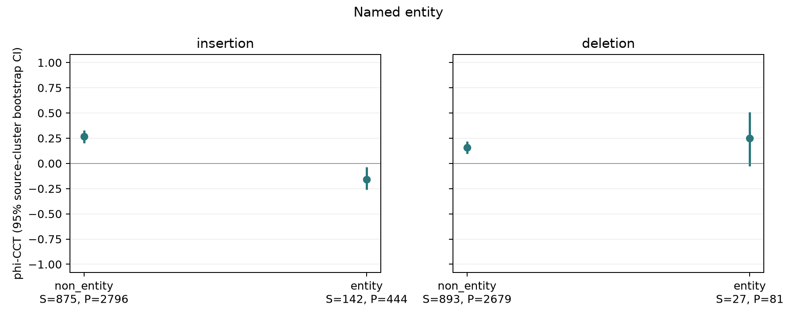

# phi-CCT on e-SNLI / Qwen3-8B

Do input features, counterfactual interventions and prompt arrangements affect the measured faithfulness of LLM self-explanations? This project tests five proposed confounders of the correlation-based phi-CCT metric, following *Verbosity Tradeoffs and the Impact of Scale on the Faithfulness of LLM Self-Explanations*.

**Completed evaluation:** 1,000 frozen sources, 9,000/9,000 valid responses and 6,000 paired comparisons. No generation or parsing failures. Final raw data, analysis and reviewed examples accompany the report.

**Main finding:** insertion named-entity status is the only check significant after correction across ten planned tests. However, that group contains only French/Canadian nationality targets. A post-hoc mention-matching check substantially changes its correlation. The evidence supports sensitivity to the operational definition of a mention; it does not establish a general causal entity effect.

Read the [two-page report](report/phi_cct_report.pdf), open the [analysis notebook](notebooks/analysis.ipynb), or follow the [Persian project guide / راهنمای فارسی](GUIDE_FA.md).

## Results at a glance

Here `I_D=1` means the model's **semantic label changes** after an edit, and `E_D=1` means the explanation mentions the edit target. `phi-CCT = corr(E_D, I_D)`. For insertion, E uses the edited explanation; for deletion, E uses the baseline explanation as a documented extension. A semantic label change is not itself evidence that a prediction or explanation is wrong.

| Intervention | Sources | Paired comparisons | phi-CCT (95% CI) | Impact rate | Mention rate |
| --- | ---: | ---: | --- | ---: | ---: |
| Insertion | 1,000 | 3,240 | 0.195 [0.137, 0.255] | 14.29% | 20.96% |
| Deletion extension | 920 | 2,760 | 0.160 [0.101, 0.219] | 16.23% | 24.02% |

Baseline accuracy is **70.7%** across 3,000 baseline responses (1,000 sources × three option layouts). The 1,000 sources, rather than the repeated responses, are the bootstrap sampling units. Complete counts and 2×2 tables are in [summary.csv](outputs/results/summary.csv); sample-by-sample completion is in [coverage.csv](outputs/results/coverage.csv).

### All five planned checks


Teal circles show insertion; orange squares show the deletion extension. Bars are 95% source-cluster bootstrap intervals. `S` gives the unique source count for insertion/deletion; sources may contribute to more than one subgroup. The negative-polarity deletion group has only 13 sources: its descriptive estimate is shown, but the planned omnibus test is non-estimable under the minimum-20-source rule.

| Variable | Insertion p | Insertion BH q | Deletion p | Deletion BH q |
| --- | ---: | ---: | ---: | ---: |
| Named entity | **0.0005** | **0.0050** | 0.5058 | 0.5620 |
| Polarity / target sentiment | 0.4503 | 0.5620 | Non-estimable | Non-estimable |
| Prompt position / target position | 0.0275 | 0.0916 | 0.2519 | 0.4473 |
| Lexical rarity / training IDF | 0.0105 | 0.0525 | 0.4708 | 0.5620 |
| Answer-option position | 0.2129 | 0.4473 | 0.2684 | 0.4473 |

These are approximate centered source-cluster bootstrap omnibus tests of equal subgroup phi. Named entity is the pre-specified primary variable; the other four are secondary. BH accounts for all ten planned tests. Lack of significance does not prove that a variable has no effect. See [tests.csv](outputs/results/tests.csv) for exact values, group counts and non-estimability reasons.

### Named entities and mention matching



In the insertion comparison, phi is **0.265** for non-entity targets and **−0.158** for entity targets. Some explanations refer to *nationality* without repeating *French* or *Canadian*, so the lexical matcher assigns E=0 despite a possible conceptual reference. An explicitly **post-hoc**, restricted proxy counts `nationality`/`nationalities` for these two targets. It adds 125 mentions and changes entity phi to **+0.257**; the subgroup difference falls from **0.424** to **0.009**. Twenty cue cases were inspected. This proxy is exploratory and is not an independently validated semantic gold standard. The primary results above remain unchanged; see [sensitivity results](outputs/results/mention_sensitivity.csv) and the [20-case audit](outputs/qualitative/nationality_proxy_audit.csv).

Individual plots, with PNG and PDF exports: [polarity](outputs/figures/target_polarity.png), [prompt position](outputs/figures/position_bin.png), [IDF](outputs/figures/idf_bin.png), [answer-option position](outputs/figures/gold_label_option_position.png), and the supplementary [position-by-role plot](outputs/figures/position_by_role.png).

## Open first

- [notebooks/analysis.ipynb](notebooks/analysis.ipynb): concise analysis-only workspace; uses the supplied project scripts/data and never runs the model.
- [notebooks/phi_cct_esnli.ipynb](notebooks/phi_cct_esnli.ipynb): **self-contained canonical notebook**, including readable Python/PyTorch implementation and checksum-verified frozen inputs/raw records. Default `replay` recomputes the complete analysis from actual recorded responses; it is not a new model execution.
- [report/phi_cct_report.pdf](report/phi_cct_report.pdf): two-page report.
- [outputs/results/](outputs/results/): coverage, accuracy, 2×2/phi/rates, all ten planned test rows, contrast intervals, plot estimates, position-by-role and verbosity tables.
- [outputs/qualitative/](outputs/qualitative/): nine traceable examples, 24 mention-rule reviews and 20 nationality-proxy reviews.
- [docs/analysis_notes.md](docs/analysis_notes.md): interpretation, supplementary matching check and limitations. [Tracing guide](docs/how_to_trace_one_example.md) explains raw-to-metric tracing.

The repository also includes [frozen inputs](data/frozen/), [selected edits and features](data/edits/), [pre-run audit records and rejected edits](data/audit/), [configuration and protocol hashes](config/), [actual JSONL checkpoints](outputs/checkpoints/), [raw response CSVs](outputs/raw/), [implementation scripts](scripts/) and the optional [local progress monitor](docs/live_monitor.md). Historical proposals and the earlier pilot are preserved for provenance and excluded from final evaluation counts.

## Reproduce

### Analysis only — no GPU or model download

Use Python 3.12. Clone the repository, install the dependencies and open the analysis notebook:

```sh
git clone https://github.com/KasraSheikhy/phi-cct-faithfulness.git
cd phi-cct-faithfulness
python3.12 -m venv .venv
source .venv/bin/activate
python -m pip install -r requirements-bootstrap.txt
python -m jupyter lab notebooks/analysis.ipynb
```

**Restart & Run All** recomputes the analysis on CPU. The canonical notebook also runs in an empty writable directory: it restores its explicitly embedded data/raw records and recomputes all results without hidden local scripts. Keep its default `RUN_MODE="replay"` and `RESTORE_RECORDED_OUTPUTS=True` to reproduce the recorded study. Dependency installation can require internet access; replay does not require model access. Recalculation overwrites generated analysis exports, so use a separate clone if you want to preserve an untouched reference.

The independent script path is:

```sh
python scripts/analyze_results.py --mode full
python -c 'from pathlib import Path; import json,sys; sys.path.insert(0,"scripts"); from review_actual_examples import run_mention_sensitivity; run_mention_sensitivity(Path.cwd(),json.loads(Path("config/experiment.json").read_text()))'
python scripts/verify_real_outputs.py
python scripts/render_report.py
```

The actual **response checkpoints** and run manifests are included for this path. Model weights, credentials, local environments, hardware-test responses and temporary runtime files are excluded. Reviewed qualitative annotations are preserved by exact edit/layout/raw-job keys. Primary calculations are shared between the two notebooks.

### Fresh model execution — GPU required

The canonical notebook retains the complete model execution path. Copy it to a clean writable working directory, set `RESTORE_RECORDED_OUTPUTS=False` and `RUN_MODE="full"`, and select a suitable MPS or CUDA GPU (automatic detection is the default). It downloads the pinned, unquantized model, runs the smoke test first and writes resumable checkpoints. Install the pinned spaCy English model if preparing edits anew; the notebook contains the setup. Keep the frozen sample and protocol unchanged for a replication. A new backend or library version can yield different responses despite greedy decoding.

The recorded model used about 15.5 GiB of GPU driver memory on a 24 GB unified-memory Mac. Budget additional memory for loading/runtime; this is an observed configuration, not a hardware-independent minimum. Use the smoke timing to estimate a new run rather than assuming the recorded timing will transfer. [Loading notes](docs/loading_notes.md) document the tested MPS strategy and initial failure.

### Verification and submission archive

[Recorded notebook verification](outputs/notebook_validation.json) documents fresh-kernel execution of both notebooks and standalone replay in an empty directory, reproducing the primary and sensitivity numbers with zero new model generations. [Raw-output verification](outputs/real_output_verification.json) records the independent semantic-label, span, coverage, contingency, correlation, accuracy and BH checks.

To repeat notebook verification or build a submission ZIP from the repository:

```sh
python scripts/validate_final_notebooks.py
python scripts/package_submission.py
```

The ZIP and its hash receipt are written to `deliverables/` (ignored by Git). No model weights or local Python environment are packaged. The [local package lock](requirements-local.lock.txt) records the exact Mac environment; [bootstrap requirements](requirements-bootstrap.txt) provide dependency ranges for other platforms.

## Exact design and environment

- Dataset: original e-SNLI **test** split, repository revision `7b585a3f077fdea899780eb0473940522ae44a2e`; the actual source CSV has 9,824 rows. Uniform sample without replacement over sorted source IDs, seed **20261115**. Counts: 340 entailment, 328 neutral, 332 contradiction. All 1,000 text pairs are distinct. Sampling and edit selection preceded any model outputs; hashes/IDs are in `data/frozen/` and `config/protocol_manifest.json`.
- IDF: 549,367 training premise+hypothesis documents only, lowercase alphabetic tokens, `log((N+1)/(df+1))+1`; target-mean IDF and frozen target-based tertiles. No output-dependent thresholds.
- Model: `Qwen/Qwen3-8B`, revision `b968826d9c46dd6066d109eabc6255188de91218`. **FP16 weights, no quantization, greedy `do_sample=False`, chat template `enable_thinking=False`, explanation then final option letter**, fresh context for each job, batch 1, maximum 256 new tokens. Truncated/malformed responses are failures, never negative observations.
- Hardware: MacBook Pro, Apple M4 Pro (16-core GPU), 24 GB unified memory, PyTorch MPS. FP16 CPU loading followed by ordinary GPU transfer avoided an oversized Metal allocator warm-up; all parameters were verified on GPU in FP16. No memory safety limit overrides or CPU inference fallback.
- Recorded versions: Python 3.12.0, PyTorch 2.15.0, Transformers 4.57.6, Accelerate 1.15.0, NumPy 2.5.4, pandas 2.3.3, SciPy 1.18.1, statsmodels 0.14.6, spaCy 3.8.18 / en_core_web_sm 3.8.0, NLTK 3.10.4. `requirements-local.lock.txt` records all installed Mac packages and is platform-specific.
- Three matched cyclic semantic-label layouts; letters are mapped back to entailment/neutral/contradiction before flips or accuracy. Gold-label displayed position is the pre-outcome anchor.
- Active edits: 1,080 insertion and 920 deletion, exactly two per source. Eighty sources without a suitable screened deletion have a second insertion. Eight historical quality-excluded proposals remain documented and are not scheduled. Insertion E uses the new explanation; deletion E uses the matched baseline explanation as an explicit extension.

## References

- Siegel et al., [assigned paper, v3](https://arxiv.org/abs/2503.13445v3); [official code](https://github.com/google-deepmind/corr_faith).
- Camburu et al., [original e-SNLI](https://github.com/OanaMariaCamburu/e-SNLI).
- [Qwen3-8B model card](https://huggingface.co/Qwen/Qwen3-8B), [spaCy English models](https://spacy.io/models/en), [NLTK VADER](https://www.nltk.org/api/nltk.sentiment.vader.html).

The optional local monitor is served at `http://127.0.0.1:8765` when started; it is not a hosted GitHub dashboard. See [monitor instructions](docs/live_monitor.md). The recorded study is already complete.
