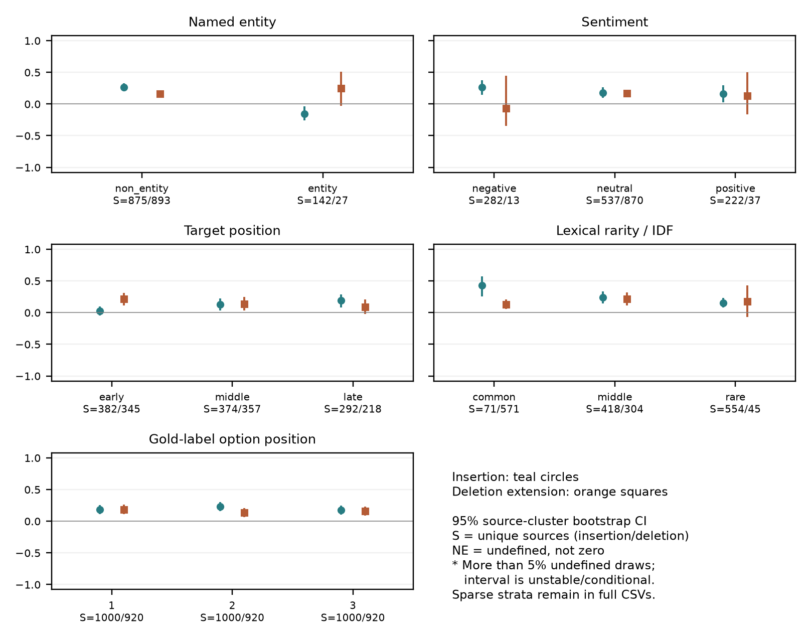

# phi-CCT on e-SNLI with Qwen3-8B

This experiment tests whether five input and prompt features affect **phi-CCT**, the correlation between mentioning a counterfactual edit and changing a prediction. Qwen3-8B was evaluated on 1,000 e-SNLI examples, producing 9,000 responses and 6,000 baseline–edit comparisons.

[Report](report/phi_cct_report.pdf) · [Analysis notebook](notebooks/analysis.ipynb) · [Full experiment notebook](notebooks/phi_cct_esnli.ipynb) · [راهنمای فارسی](GUIDE_FA.md)

## Experiment

| Component | Setting |
| --- | --- |
| Data | 1,000 distinct e-SNLI test examples, sampled without replacement; seed `20261115` |
| Model | `Qwen/Qwen3-8B`, FP16, no quantization |
| Generation | Greedy decoding, thinking disabled, explanation before the answer; batch size 1, maximum 256 new tokens |
| Edits | Two per example: 1,080 insertions and 920 deletions overall |
| Option order | Three cyclic label layouts; answer letters mapped back to semantic labels before comparison |
| Features tested | Named entity, polarity, target position, lexical rarity / training IDF, answer-option position |
| Uncertainty | 2,000 source-level bootstrap draws; 95% intervals; BH correction across ten tests |

Each source has one baseline and two edited inputs under each option layout: `1,000 × 3 × 3 = 9,000` responses. Eighty sources had no suitable deletion and received a second insertion. Sampling, edit selection and feature bins were fixed before model outputs. The prompt requested one explanatory sentence of at most 25 words; longer responses were retained.

The evaluated hardware was an Apple M4 Pro with 24 GB unified memory, using PyTorch MPS. Pinned data/model revisions and settings are in [experiment.json](config/experiment.json); file hashes are in [protocol_manifest.json](config/protocol_manifest.json). The recorded environment is in [requirements-local.lock.txt](requirements-local.lock.txt).

## Metric and implementation

`I_D = 1` when the model's **semantic label** changes after an edit. `E_D = 1` when the explanation mentions the target, using whole-token or contiguous Snowball-stem matching. Insertion uses the edited explanation; deletion uses the baseline explanation as an extension of the insertion test. Generation and parsing failures are excluded from the correlation, rather than assigned zero. Constant margins give an undefined phi.

The following runs from the repository root and traces one stored comparison, then recomputes each intervention's contingency table and phi:

```python
import pandas as pd
from scripts.experiment_core import contingency, mention_flags

pairs = pd.read_csv("outputs/results/paired_metrics.csv")
valid = pairs.loc[pairs["validity_status"].eq("valid")]
row = valid.iloc[0]

explanation = (
    row["edited_explanation"]
    if row["family"] == "insertion"
    else row["baseline_explanation"]
)
e_d = mention_flags(explanation, row["target"])["E_D"]
i_d = int(row["baseline_semantic_label"] != row["edited_semantic_label"])
assert (e_d, i_d) == (row["E_D"], row["I_D"])

for family, group in valid.groupby("family"):
    result = contingency(zip(group["E_D"], group["I_D"]))
    print(family, {k: result[k] for k in ("n00", "n01", "n10", "n11", "phi")})
```

| Code | Responsibility |
| --- | --- |
| [experiment_core.py](scripts/experiment_core.py) | Prompt, explanation-first parser, semantic-label mapping, mention matching and phi |
| [run_inference.py](scripts/run_inference.py) | FP16 model loading, generation and resumable response checkpoints |
| [prepare_edits.py](scripts/prepare_edits.py) / [complete_edits.py](scripts/complete_edits.py) | Counterfactual construction, features and fallback edits |
| [analyze_results.py](scripts/analyze_results.py) | Paired comparisons, bootstrap intervals, subgroup tests and plots |
| [review_actual_examples.py](scripts/review_actual_examples.py) | Qualitative records and post-hoc mention sensitivity |

## Results

All 9,000 responses were valid. Baseline accuracy was **70.7%** across 3,000 baseline responses.

| Intervention | Sources | Comparisons | phi-CCT (95% CI) | Impact rate | Mention rate |
| --- | ---: | ---: | --- | ---: | ---: |
| Insertion | 1,000 | 3,240 | 0.195 [0.137, 0.255] | 14.29% | 20.96% |
| Deletion extension | 920 | 2,760 | 0.160 [0.101, 0.219] | 16.23% | 24.02% |



Teal circles indicate insertion; orange squares indicate deletion. `S` gives the source count for each family. Sources can appear in multiple feature levels. The deletion-polarity test is non-estimable because its negative group has only 13 sources, below the minimum of 20.

Named entity was the primary feature; the other four were secondary. Only insertion named-entity status survived BH correction (`p=0.0005`, `q=0.005`): phi was **0.265** for non-entity targets and **−0.158** for entity targets. The entity insertions were exclusively *French* and *Canadian*, so this comparison does not identify a general causal entity effect.

A post-hoc check also counted `nationality`/`nationalities` as mentions of those two targets. Entity phi became **0.257**, and the subgroup gap fell from **0.424** to **0.009**. This shows sensitivity to mention matching; the proxy has no independent semantic gold standard. Feature/template overlap and limited pre-run edit review also constrain interpretation.

Exact [test results](outputs/results/tests.csv), [2×2 tables and rates](outputs/results/summary.csv), [sensitivity results](outputs/results/mention_sensitivity.csv), [coverage](outputs/results/coverage.csv) and [qualitative examples](outputs/qualitative/qualitative_examples.csv) are included. [Analysis notes](docs/analysis_notes.md) describe the interpretation and limitations.

## Reproduce the analysis

Python 3.12. Analysis uses the recorded responses and requires no GPU or model download.

```sh
git clone https://github.com/KasraSheikhy/phi-cct-faithfulness.git
cd phi-cct-faithfulness
python3.12 -m venv .venv
source .venv/bin/activate
python -m pip install -r requirements-bootstrap.txt
python scripts/reproduce_analysis.py
```

This recomputes the primary results and post-hoc sensitivity in `outputs/results/` and regenerates the figures. To view the tables, figures and examples in Jupyter:

```sh
python -m jupyter lab notebooks/analysis.ipynb
```

The analysis notebook runs the same calculations. The [full experiment notebook](notebooks/phi_cct_esnli.ipynb) contains the complete pipeline and can replay the recorded responses.

## Run fresh model inference

Copy the full experiment notebook into a separate working directory. Set these variables in its configuration cell, then run all cells:

```python
RUN_MODE = "full"
RESTORE_RECORDED_OUTPUTS = False
BACKEND = "auto"  # MPS or CUDA
```

The notebook downloads the pinned FP16 model, runs a smoke test and saves resumable checkpoints. The recorded Mac run used about 15.5 GiB of GPU driver memory; loading and runtime need additional headroom. Different hardware or library versions may change responses. [MPS loading notes](docs/loading_notes.md) document the tested loading path.

Frozen inputs are under [data/](data/), raw response CSVs under [outputs/raw/](outputs/raw/), and JSONL response checkpoints under [outputs/checkpoints/](outputs/checkpoints/).

## References

- [Verbosity Tradeoffs and the Impact of Scale on the Faithfulness of LLM Self-Explanations](https://arxiv.org/abs/2503.13445v3), with [reference code](https://github.com/google-deepmind/corr_faith).
- [e-SNLI](https://github.com/OanaMariaCamburu/e-SNLI).
- [Qwen3-8B](https://huggingface.co/Qwen/Qwen3-8B).

## License and citation

Code is licensed under [MIT](LICENSE). Dataset text and the bundled lexicon retain their upstream terms; see [third-party notices](THIRD_PARTY_NOTICES.md). Citation metadata is in [CITATION.cff](CITATION.cff).
